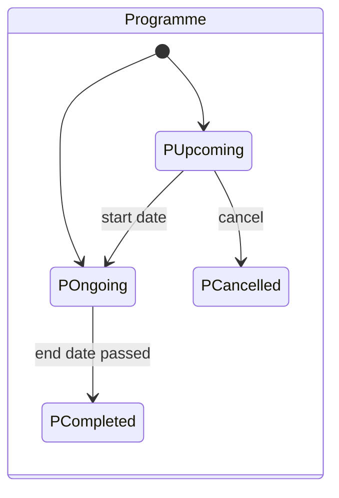
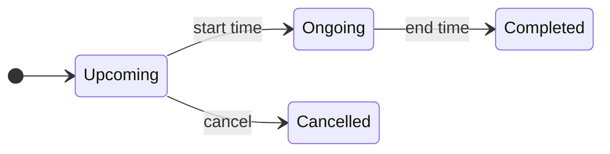

# Functional Requirements Specification (PRD)
## Standalone AMS — Flow 1: Training Programmes, Sessions and Attendance

| | |
|---|---|
| Version | 1.1 draft |
| Changes in 1.1 | Accepted: substitute supervisors (FR-ATT-18 to 20), athletes added after start (FR-ATT-21, 22), Added in error (FR-ATT-23, 24), Late / Left early (FR-ATT-25), Admin unmarked list (FR-ATT-26, 27) |
| Date | 2026-11-26 |
| Audience | Development, QA, Design |
| Status | **Draft.** Core decisions are locked. Items tagged **[D#]** are proposed defaults awaiting product confirmation (section 18). |

**Reading this document:** "shall" is a requirement. Every requirement has an ID for tickets and test cases. This document stands alone for Flow 1 and replaces earlier Flow 1 drafts where they differ.

---

## 1. Overview

### 1.1 Purpose
A High Performance Centre develops athletes across several sports. Many staff disciplines plan work with the same athletes. This flow lets staff plan programmes, schedule sessions without avoidable clashes, and record attendance, while protecting sensitive sessions.

### 1.2 Goals
1. Any staff member can create programmes and sessions.
2. Staff can tell which sessions they run, created, or are involved in.
3. Attendance can be marked on a phone, with every change traceable.
4. Sensitive support is not disclosed to people who should not see it.

### 1.3 In scope
Programmes, phases, collaborators, one-time and recurring sessions, clash checks, calendar and session views, private sessions, attendance, leave, athlete view, notifications, reporting.

### 1.4 Out of scope
| Item | Note |
|---|---|
| Injury, medical attention, availability status, return to play | Flow 2, still being verified |
| Guardian role, views and notifications | Removed from all flows until requested |
| Training load (RPE) capture | Phase 2; data fields reserved (FR-ATT-17) |
| Offline marking | Phase 3 |
| Competition results and handling | Competition/Match is a label only |
| Assessments, wellness, readiness, alerts | Separate modules |
| Onboarding, user import, roster and venue management screens | Prerequisites (1.5) |

### 1.5 Prerequisites
- Staff and athletes are onboarded with roles.
- At least one active **Venue** and one active **Roster** with a member exist before a programme is created.
- **Roster:** name; one sport from a predefined list; gender Male or Female; no age group; one or more Coaches and one Team Manager (both required). Only Admin creates, edits or deletes rosters. Admin and the roster's Team Manager manage members. Sport and gender lock once the roster has sessions. Deleting a roster removes it from Upcoming sessions after confirmation; past sessions keep it. Sessions it is removed from keep their other athletes.
- **Venue:** name, centre (optional), notes. No capacity.

---

## 2. Users and roles

| Group | Roles |
|---|---|
| Staff | Admin, Coach, Team Manager, S&C Coach, Medic, Physio, Psychologist, Biomechanist, Nutritionist, Performance Analyst |
| Participant | Athlete (view only) |

| ID | Requirement |
|---|---|
| FR-ROL-01 | A person with several roles shall act in one role at a time and switch between them. |
| FR-ROL-02 | Programmes, sessions, collaborator entries and supervisor assignments shall store the role used. Personal views shall show only the active role's items. **[D1]** |
| FR-ROL-03 | Clash checks shall apply to the person across all their roles. |
| FR-ROL-04 | Every change shall record the actor and active role. |

---

## 3. Concepts and lifecycle

**Programme → Schedule Pattern → Session → Attendance record.** A one-time session has no pattern. Every session belongs to one programme.

| Term | Meaning |
|---|---|
| Programme | A dated plan owned by one staff member |
| Phase | Named date range within a programme. A label only; it controls nothing |
| Schedule pattern | The rule for a recurring series |
| Session | One dated occurrence, and the unit that is run and marked |
| Supervisor | Staff assigned to run a session |
| Collaborator | Staff invited to add sessions to someone's programme |

### 3.1 States

| ID | Requirement |
|---|---|
| FR-STA-01 | State changes based on time shall be automatic, using the organisation's timezone. |
| FR-STA-02 | A new record shall take the state that matches its dates and times. No intermediate "Published" state shall be visible. |
| FR-STA-03 | Completed and Cancelled are terminal. |
| FR-STA-04 | Conduct outcome shall be Conducted (default) or Not Conducted with a reason: Holiday, Weather, Facility Unavailable, Staff Unavailable, Other. |
| FR-STA-05 | Cancelled means called off in advance. Not Conducted means it did not happen as scheduled, recorded once it was Ongoing or Completed. |

### 3.2 Allowed actions by state
| Record | Delete | Cancel | Edit |
|---|---|---|---|
| Upcoming programme | Yes, permanent **[D2]** | Yes | All fields |
| Ongoing programme | No | No | Dates within FR-PRG-09; participants; collaborators |
| Completed or Cancelled programme | No | No | None |
| Upcoming session | Yes, permanent **[D2]** | Yes | All fields, within FR-PVT-04 |
| Ongoing or Completed session | No | No | Attendance, notes, conduct outcome, added supervisors (FR-ATT-18), athlete additions and corrections (FR-ATT-21, 23) |
| Cancelled session | No | No | None |

A completed programme does not lock attendance, notes or conduct outcome on its sessions.

---

## 4. Programmes

**User story:** As a staff member, I want to create and manage a programme so that I can plan my area of work.

| ID | Requirement |
|---|---|
| FR-PRG-01 | Any staff role shall be able to create a programme and becomes its owner. |
| FR-PRG-02 | Required: name, at least one sport (predefined list), start date, end date. Optional: phases (name, dates, focus). |
| FR-PRG-03 | End date shall not precede start date. Phases shall fall within programme dates. |
| FR-PRG-04 | Name shall be unique within organisation and sport. **[D4]** |
| FR-PRG-05 | A programme wholly in the past shall not be created. **[D5]** |
| FR-PRG-06 | A programme with no athletes or sessions shall be allowed and show "No sessions scheduled". |
| FR-PRG-07 | The owner and Admin shall be able to edit the programme. |
| FR-PRG-08 | Cancelling a programme shall cancel all its Upcoming sessions after confirmation. |
| FR-PRG-09 | An Ongoing programme may be extended. It may be shortened only to the date of the last session with an attendance record (not Not Marked) or a Not Conducted outcome. Sessions beyond the new end date must be deleted or cancelled first. |
| FR-PRG-10 | Changing an Upcoming programme's dates shall be blocked while any session would fall outside them. **[D18]** |
| FR-PRG-11 | Extending a programme shall generate sessions from every active pattern whose range is extended, with the clash summary (section 7). A pattern ending on the programme end date extends with it; a pattern with an earlier end date does not. |
| FR-PRG-12 | An owner shall not permanently delete a programme containing sessions they cannot manage. The message shall not describe them. Cancelling is allowed and notifies their supervisors. **[D20]** |
| FR-PRG-13 | If the owner is deactivated, Admin shall manage the programme until it is reassigned. Private content rules still apply. |

---

## 5. Participants and collaborators

**User story:** As a programme owner, I want to add athletes and other staff so that one programme can hold an athlete's coordinated plan.

| ID | Requirement |
|---|---|
| FR-PAR-01 | The owner and Admin shall add or remove rosters and individual athletes. |
| FR-PAR-02 | An athlete reached through several rosters or individually shall count once. |
| FR-PAR-03 | Removing an athlete shall keep history and remove them from Upcoming sessions only. |
| FR-PAR-04 | An added athlete or roster member shall appear from the next Upcoming session that includes that roster or the programme's participants. |
| FR-PAR-05 | An athlete may belong to many programmes and rosters. |
| FR-PAR-06 | Deactivating an athlete shall keep their history and name, and remove them from Upcoming sessions. |
| FR-COL-01 | The owner and Admin shall add or remove any staff member as a collaborator. |
| FR-COL-02 | A collaborator shall add sessions and edit, cancel or delete only their own, within section 3.2. |
| FR-COL-03 | A collaborator shall schedule programme participants only and shall not change them. **[D6]** |
| FR-COL-04 | The owner or Admin may add a non-participant to a single session without adding them to the programme. **[D21]** |
| FR-COL-05 | Removing a collaborator shall keep their sessions; the owner manages non-private ones. Their supervisor assignments remain until changed. |

---

## 6. Sessions and scheduling

**User story:** As an owner or collaborator, I want to schedule one-time and recurring sessions so that everyone knows what happens when.

### 6.1 Session types (fixed list, not user-editable)
Training · Strength & Conditioning · Recovery · Competition/Match · Assessment/Testing · Meeting/Camp Admin · Psychology

| ID | Requirement |
|---|---|
| FR-SES-01 | Any staff role may create any type except Psychology, which only a Psychologist may create. |
| FR-SES-02 | The programme owner, collaborators and Admin may add sessions to a programme. |
| FR-SES-03 | One "Schedule Session" form shall offer a One-time / Recurring toggle. |
| FR-SES-04 | Required: date or recurrence, start time, end time, venue, type, at least one athlete, at least one supervisor. Optional: objectives. |
| FR-SES-05 | Any staff member may be a supervisor, subject to FR-PVT-03. Multiple supervisors are allowed. |
| FR-SES-06 | Selecting a roster shall prefill its Coaches as supervisors; the user may change them. |
| FR-SES-07 | Sessions shall fall within programme dates. An end time earlier than the start time means the next day; the session is dated by its start. Equal times are invalid. |
| FR-SES-08 | A past-dated session may be created up to 30 days back, with a reason, and shall be marked "reconstructed". |

### 6.2 Recurring series
| ID | Requirement |
|---|---|
| FR-REC-01 | A pattern shall hold label, weekdays, times, venue, type, athletes, supervisors, date range and skip-dates. |
| FR-REC-02 | Saving shall create individual session records. Retrying a save shall not create duplicates. |
| FR-REC-03 | A programme may have several active patterns. |
| FR-REC-04 | Series edits shall offer "this session only" or "this and following", affecting only Upcoming sessions of that pattern. |
| FR-REC-05 | A session edited on its own shall be marked detached and ignore later series edits. |
| FR-REC-06 | The programme page shall list patterns with edit, stop and skip-date actions. |
| FR-REC-07 | Stopping a pattern shall end further generation and keep existing sessions until individually cancelled or deleted. **[D7]** |

---

## 7. Clash checks

| ID | Requirement |
|---|---|
| FR-CLS-01 | Checks shall run on create, edit, series generation and extension. |
| FR-CLS-02 | All results shall appear in one summary before saving. |
| FR-CLS-03 | Two sessions overlap when each starts before the other ends. Back-to-back sessions do not. Cancelled sessions are ignored. |
| FR-CLS-04 | The system shall re-check at save time so that two simultaneous bookings cannot both bypass a block. |

| Clash | Result |
|---|---|
| Supervisor double-booked | **Block** |
| Venue double-booked | Warning. "Continue as shared venue" marks both with a Shared venue badge |
| Athlete double-booked | Warning listing athletes |
| Organisation holiday (list maintained by Admin) **[D22]** | Warning |
| Pattern skip-date | No session generated; shown in the summary |

| ID | Requirement |
|---|---|
| FR-CLS-05 | The Shared venue badge shall be removed when the overlap no longer exists. |
| FR-CLS-06 | Clash messages involving a private session the user cannot see shall follow FR-PVT-07. |

---

## 8. Calendar and session views

**User story:** As a staff member, I want separate views so that I can tell my work from other people's.

| View | Contains |
|---|---|
| Assigned to me (default) **[D23]** | Sessions I supervise |
| Created by me | Sessions I created |
| Involved | Sessions in a programme I own or collaborate on that are in neither view above |
| Organisation | All sessions, subject to private rules |

| ID | Requirement |
|---|---|
| FR-VIEW-01 | A session that is both assigned and created shall appear in both views with badges. |
| FR-VIEW-02 | Views shall offer calendar and list layouts, with filters for date, programme, type and athlete. |
| FR-VIEW-03 | Each session card shall show type, time, venue, state, the user's relationship and unmarked count where relevant. |
| FR-VIEW-04 | Opening a view shall grant no extra rights; actions follow section 13. |

---

## 9. Private sessions

**User story:** As a psychologist or clinician, I want sensitive sessions kept private so that an athlete's support is not disclosed.

| ID | Requirement |
|---|---|
| FR-PVT-01 | Every Psychology session shall be private. |
| FR-PVT-02 | A Recovery session created in the Medic or Physio role shall be private. **[D12]** Privacy is set automatically and cannot be switched off. |
| FR-PVT-03 | Supervisors shall be limited to Psychologists for Psychology, and Medics or Physios for private rehab. **[D13]** |
| FR-PVT-04 | An existing session or pattern shall not be changed between private and non-private. The user creates a new one instead. **[D19]** |
| FR-PVT-05 | Full details are visible only to the session's supervisors and its athletes. Athletes shall not see other athletes in the session. **[D14]** |
| FR-PVT-06 | Everyone else, **including Admin, coaches, the programme owner and collaborators**, shall see only "Unavailable", the athlete and the time. No title, type, programme, venue, supervisor, objectives, notes or attendance. |
| FR-PVT-07 | Clash messages shall say only "Athlete is unavailable", "Venue is booked" or "Supervisor is unavailable". |
| FR-PVT-08 | Only the private session's supervisors may edit, cancel, delete, mark attendance, add or exclude athletes, add notes or set Not Conducted. This overrides section 13. The one exception is assigning a substitute (FR-PVT-13). |
| FR-PVT-09 | **Enforcement shall be server-side** for every screen, API response, search, filter, count, export, report, notification, reminder, error message and audit view. Restricted data shall not be sent to the client. |
| FR-PVT-10 | Private sessions shall be excluded from attendance percentages, hours, summaries and reports. Athletes and supervisors see their private records separately. |
| FR-PVT-11 | Recording or approving leave shall not reveal affected private sessions to the person recording it. Their supervisors see the leave. |
| FR-PVT-12 | A programme owned in the Psychologist role shall be visible only to its owner, collaborators and athletes. **[D15]** Collaborators still see only "Unavailable" for private sessions they do not supervise. |
| FR-PVT-13 | An existing supervisor or Admin may assign an eligible substitute (FR-PVT-03) to a private session at any time before it is Cancelled, including when a supervisor is absent without warning. A reason is required and the action is audited. Admin shall not see content, and gains no right to view or mark. Admin shall not assign themselves **[D28]**. All existing supervisors are notified. The substitute gains access to that session only. |
| FR-PVT-14 | Notifications shown outside the signed-in app shall not reveal type or title. |

---

## 10. Attendance

**User story:** As an assigned supervisor, I want to mark attendance on my phone so that the record is accurate.

### 10.1 Statuses
| Status | Group |
|---|---|
| Present | Attended |
| Absent, Leave | Missed |
| Approved Leave, Holiday, In-Competition, In-Recovery, In S&C | Excused |
| Not Marked | Not counted; shown as a number |

| ID | Requirement |
|---|---|
| FR-ATT-01 | One record shall exist per session and athlete, even if the athlete is on two included rosters. |
| FR-ATT-02 | The session's athlete list shall be frozen at start. Later roster or participant changes shall not alter it. A reconstructed session freezes the list chosen at creation. The only exceptions are FR-ATT-21 and FR-ATT-23. |
| FR-ATT-03 | Marking shall be allowed only when the session is Ongoing or Completed, enforced server-side. |
| FR-ATT-04 | Assigned supervisors of any staff role may mark. Admin may mark any non-private session. Others may only view. |
| FR-ATT-05 | Records shall default to Not Marked, except where leave applies. |
| FR-ATT-06 | "Mark all Present" shall change only Not Marked records. **[D8]** |
| FR-ATT-07 | A reason shall be required for every status except Present. |
| FR-ATT-08 | Marking shall have no closing deadline. |
| FR-ATT-09 | Every change shall store actor, active role, time, old value, new value and reason. History shall show on the record and cannot be edited or deleted. |
| FR-ATT-10 | For concurrent edits, the latest write shall apply; both are audited, and the later user is told the record had changed. **[D24]** |
| FR-ATT-11 | Supervisors and Admin may add session notes and set Not Conducted with a reason, within FR-PVT-08. Notes are visible to staff, not athletes. **[D25]** |
| FR-ATT-12 | Not Conducted sessions shall be excluded from all percentages and hours trained. Existing records are kept and flagged. |
| FR-ATT-13 | Supervisors shall be reminded of Not Marked records 30 minutes after the session ends and again the next morning. **[D10]** |
| FR-ATT-14 | There is no "Medically Unavailable" status. Until Flow 2, In-Recovery shall be used with a non-clinical reason, and the screen shall tell users not to enter medical details. **[D9]** |
| FR-ATT-15 | Marking shall be a lightweight phone screen usable on a poor connection. A failed save shall be shown clearly and never appear saved. |
| FR-ATT-16 | The status list and pre-marking logic shall be extendable so Flow 2 can add availability without migrating records. |
| FR-ATT-17 | Fields for RPE, load, entered by and source shall be reserved. No capture screen is built. |

### 10.2 Substitute supervisors
**User story:** As the person responsible for a session, I want to add a substitute when a supervisor does not show up, so that attendance can still be taken.

| ID | Requirement |
|---|---|
| FR-ATT-18 | For a non-private session that is Ongoing or Completed, its creator (while owner, collaborator or Admin), the programme owner or Admin shall be able to add any staff member as a substitute supervisor. A reason is required. For private sessions, FR-PVT-13 applies. |
| FR-ATT-19 | Earlier supervisor assignments shall be kept. The substitute is labelled "Substitute", is notified, and gets supervisor rights for that session only. |
| FR-ATT-20 | The supervisor double-booking block (section 7) shall apply to substitutes. |

### 10.3 Athlete list corrections
**User story:** As a supervisor, I want to correct who was on the list, so that attendance matches what happened.

| ID | Requirement |
|---|---|
| FR-ATT-21 | While Ongoing or Completed, a supervisor (or Admin, non-private only) shall be able to add an active athlete of the organisation to this session only, with a reason. The entry is labelled **Added after start** and starts as Not Marked, or Leave if leave applies. |
| FR-ATT-22 | Such an addition shall not change the programme, roster or pattern. It follows FR-ATT-01 (one record per athlete) and shows the athlete clash warning. The athlete is notified and can see the session. |
| FR-ATT-23 | A supervisor (or Admin, non-private only) shall be able to mark an athlete's entry **Added in error**, with a reason. It is a flag on the entry, not an attendance status. The entry and its history are kept and visible to those who can manage the session. It can be reversed with a reason. |
| FR-ATT-24 | A flagged entry shall be excluded from percentages, status counts, hours, reports, reminders, unmarked counts, "Mark all Present" and leave pre-marking. It is removed from the athlete's view, including private-session access. **[D29]** Flagged entries do not count as attendance records for FR-PRG-09. |

### 10.4 Late and left early
| ID | Requirement |
|---|---|
| FR-ATT-25 | A Present record may carry optional **Late** and **Left early** labels (either or both) with an optional note. They need no reason and do not change percentages or hours; partial attendance is not calculated. Changing the status away from Present removes the labels, with the change kept in history. |

### 10.5 Unmarked follow-up
**User story:** As an Admin, I want to see unmarked completed sessions, so that attendance does not stay missing.

| ID | Requirement |
|---|---|
| FR-ATT-26 | Admin shall have a list of Completed, Conducted, non-private sessions with Not Marked records, showing date, programme, supervisors and unmarked count, filterable by supervisor. Sessions leave the list once nothing is unmarked. |
| FR-ATT-27 | A **Remind** action shall notify that session's supervisors and show when the last reminder was sent. Private sessions shall never appear in the list or its counts; their supervisors receive the automatic reminders (FR-ATT-13). |

---

## 11. Leave

**User story:** As an Admin or Coach, I want to record leave so that attendance reflects it.

| ID | Requirement |
|---|---|
| FR-LV-01 | Admin may record leave for any athlete. A Coach may record it for athletes in their rosters or sessions. Athletes cannot submit leave. |
| FR-LV-02 | Leave requires athlete, from date, to date and reason. |
| FR-LV-03 | Sessions in the period, including those created later, shall be pre-marked Leave. |
| FR-LV-04 | Only Admin may approve leave, changing it to Approved Leave. |
| FR-LV-05 | Leave added, approved or removed after attendance was marked shall change those records only after the user reviews and confirms. Hidden private sessions follow FR-PVT-11: their supervisors confirm. **[D11]** |
| FR-LV-06 | For Upcoming sessions, editing or removing leave shall update pre-marked records. |

---

## 12. Athlete view, notifications and reporting

### 12.1 Athlete view
**User story:** As an athlete, I want my sessions and attendance in one place so that I know where to be.

| ID | Requirement |
|---|---|
| FR-ATH-01 | Calendar and list of the athlete's own sessions: time, venue, type, supervisor, objectives, state. |
| FR-ATH-02 | Own attendance records, Attendance % and Engagement %. Private records appear separately. |
| FR-ATH-03 | Read only. No access to other athletes' records, rankings or staff notes. |

### 12.2 Notifications **[D17]**
| Event | Recipients |
|---|---|
| Session or series created, rescheduled, venue changed, cancelled or deleted | Affected athletes and supervisors |
| Supervisor added or removed | That staff member |
| Added or removed as collaborator | That staff member |
| Athlete added to or removed from an Upcoming session | That athlete |
| Unmarked attendance (automatic or Admin **Remind**) | Supervisors |
| Substitute assigned to a private session | Substitute and existing supervisors |

| ID | Requirement |
|---|---|
| FR-NTF-01 | A series action shall send one summary per recipient, not one per session. |
| FR-NTF-02 | In-app notifications are required. Other channels are to be agreed with development. |
| FR-NTF-03 | A failed notification shall not undo the underlying action. |

### 12.3 Reporting and programme summary
| Measure | Definition |
|---|---|
| Attendance % | Present ÷ (Present + Missed) |
| Engagement % | (Present + Excused) ÷ (Present + Missed + Excused) |

*Example:* 6 Present, 2 Missed, 2 Excused → Attendance 75%, Engagement 80%.

| ID | Requirement |
|---|---|
| FR-RPT-01 | Reports shall be available by athlete, roster, programme and phase. |
| FR-RPT-02 | Show attendance %, engagement %, status counts including Not Marked, sessions by type and hours trained. Hours count Present records on Conducted sessions, using scheduled duration. **[D26]** |
| FR-RPT-03 | A zero denominator shall show "—". |
| FR-RPT-04 | Not Conducted, Cancelled and private sessions shall be excluded from percentages. |
| FR-RPT-05 | Users shall be able to include or exclude reconstructed sessions. |
| FR-RPT-06 | All staff may view reports; athletes see only their own figures. CSV export follows the same rules. **[D27]** |
| FR-PRG-14 | When a programme completes, it shall show a summary by athlete with the FR-RPT-02 measures and Not Conducted count. Later attendance corrections update it. |

---

## 13. Permissions matrix
✔ allowed · — not allowed. **Section 9 overrides this table for private sessions.**

| Action | Admin | Programme owner | Collaborator | Session creator | Assigned supervisor | Other staff | Athlete |
|---|---|---|---|---|---|---|---|
| Create own programme | ✔ | ✔ | ✔ | ✔ | ✔ | ✔ | — |
| Edit programme, participants, collaborators | ✔ | ✔ | — | — | — | — | — |
| Add session | ✔ | ✔ | ✔ | — | — | — | — |
| Edit / cancel / delete session or series | ✔ | ✔ **[D3]** | Own only | ✔ while owner, collaborator or Admin | — | — | — |
| Mark attendance, notes, Not Conducted | ✔ | If supervisor | If supervisor | If supervisor | ✔ | — | — |
| View non-private records | ✔ | ✔ | ✔ | ✔ | ✔ | ✔ | Own |

Columns describe a person's relationship to a record; a person gets every right from each column that applies. Psychology-owned programmes follow FR-PVT-12.

| Role-based action | Who |
|---|---|
| Add substitute after start, non-private | Session creator (FR-ATT-18), programme owner, Admin |
| Assign substitute, private | Existing supervisor, Admin (not themselves) |
| Add athlete after start; mark Added in error | Supervisors; Admin for non-private |
| View unmarked list and send reminders | Admin |
| Create Psychology session | Psychologist |
| Create, edit, delete rosters | Admin |
| Manage roster members | Admin, that roster's Team Manager |
| Record leave | Admin; Coach (FR-LV-01) |
| Approve leave | Admin |

---

## 14. Data requirements

| Entity | Key fields |
|---|---|
| Programme | id, organisation, name, sports, start, end, owner and role, status |
| Phase | programme, name, start, end, focus |
| Participant | programme, athlete or roster, added/removed time |
| Collaborator | programme, person, role, added by, added/removed time |
| Pattern | programme, label, weekdays, times, venue, type, athletes, supervisors, range, skip-dates, status, creator and role, private |
| Session | programme, pattern (nullable), date, start, end, venue, type, athletes, supervisors and roles, objectives, notes, status, outcome and reason, private, shared venue, detached, reconstructed and reason, creator and role |
| Attendance | session, athlete, status, reason, marker and role, timestamps, late, left early, note, added after start and reason, added in error and reason, RPE, load, entered by, source |
| Supervisor assignment | session, person, role, substitute flag, reason, assigned by, time |
| Reminder | session, sent by, recipients, time |
| Attendance history | record, actor, role, time, old, new, reason |
| Leave | athlete, from, to, reason, recorder, approved, approver, timestamps |
| Organisation holiday | date, name |
| Audit event | actor, role, action, entity, time, before, after |

---

## 15. Non-functional requirements
| ID | Requirement |
|---|---|
| NFR-01 | All permissions and state rules shall be enforced server-side. |
| NFR-02 | Data shall be isolated by organisation. |
| NFR-03 | Audit records shall be append-only, including for permanent deletes. Private audit content follows FR-PVT-09. |
| NFR-04 | Attendance marking and athlete views shall work on phone screens; all screens shall work on desktop. |
| NFR-05 | Status shall not be shown by colour alone; aim for WCAG 2.1 AA. |
| NFR-06 | Each screen shall have loading, empty, error and permission-denied states. |
| NFR-07 | Athlete data includes minors and sensitive support information. Encrypt in transit and at rest; do not write private content to application logs. |
| NFR-08 | Performance, volume, retention and availability targets are **to be agreed** with development before build estimates are final. |

---

## 16. Acceptance tests
| ID | Given / When | Then | Covers |
|---|---|---|---|
| AT-01 | A Nutritionist creates a Training session and supervises it | Can create and mark | FR-SES-01, FR-ATT-04 |
| AT-02 | A Coach tries to create Psychology, by screen or API | Not offered; rejected | FR-SES-01 |
| AT-03 | Admin opens or requests a private session | Only "Unavailable", athlete, time; no other data in response | FR-PVT-06, 09 |
| AT-04 | Admin exports a report covering a private session | No private data or counts | FR-PVT-10 |
| AT-05 | A Coach books an athlete over a private session | "Athlete is unavailable"; can continue | FR-PVT-07 |
| AT-06 | A user changes a Psychology session to Training | Rejected | FR-PVT-04 |
| AT-07 | A collaborator edits someone else's session | Rejected | FR-COL-02 |
| AT-08 | A supervisor is booked into overlapping sessions | Blocked | Section 7 |
| AT-09 | One person is Coach and Physio with overlapping supervision | Blocked | FR-ROL-03 |
| AT-10 | Two users book the same supervisor simultaneously | Only one save succeeds | FR-CLS-04 |
| AT-11 | A shared-venue session's overlap is removed | Badge disappears | FR-CLS-05 |
| AT-12 | "This and following" edit on a series with a detached session | Detached session unchanged | FR-REC-05 |
| AT-13 | Marking an Upcoming or Cancelled session | Rejected | FR-ATT-03 |
| AT-14 | "Mark all Present" with one athlete on leave | Leave unchanged | FR-ATT-06 |
| AT-15 | Athlete is on two rosters in one session | One record | FR-ATT-01 |
| AT-16 | Roster changes after session start | Session list unchanged | FR-ATT-02 |
| AT-17 | Attendance corrected after the programme completes | Saved, audited, summary updated | FR-ATT-08, FR-PRG-14 |
| AT-18 | Session set to Not Conducted after marking | Records kept, excluded | FR-ATT-12 |
| AT-19 | 6 Present, 2 Missed, 2 Excused | 75% and 80% | 12.3 |
| AT-20 | All records Not Marked | Percentages show "—" | FR-RPT-03 |
| AT-21 | Leave recorded over a marked session | No change until confirmed | FR-LV-05 |
| AT-22 | Delete an Ongoing session | Rejected | 3.2 |
| AT-23 | Shorten a programme past its last marked session | Rejected | FR-PRG-09 |
| AT-24 | Athlete requests another athlete's record | Denied | FR-ATH-03 |
| AT-25 | Athlete deactivated | History and name kept; removed from Upcoming | FR-PAR-06 |
| AT-26 | Backdated session 31 days old | Rejected | FR-SES-08 |
| AT-27 | Programme owner adds a substitute to an Ongoing non-private session | Substitute can mark; earlier assignment kept; reason audited | FR-ATT-18, 19 |
| AT-28 | Substitute is already supervising at that time | Blocked | FR-ATT-20 |
| AT-29 | Admin assigns a substitute to a private session | Saved; Admin sees no content and cannot mark; supervisors notified | FR-PVT-13 |
| AT-30 | Admin assigns themselves, or an ineligible role, to a private session | Rejected | FR-PVT-03, 13 |
| AT-31 | Supervisor adds an unlisted athlete after start | One record, labelled Added after start; programme and roster unchanged | FR-ATT-21, 22 |
| AT-32 | Entry marked Added in error | Gone from reports, counts and athlete view; history kept; reversible | FR-ATT-23, 24 |
| AT-33 | Present athlete labelled Late, then changed to Absent | Percentages unaffected by label; label removed on change; history kept | FR-ATT-25 |
| AT-34 | Admin opens unmarked list when a private session is unmarked | Private session absent from list and counts; its supervisors are reminded | FR-ATT-26, 27 |

---

## 17. Dependencies and risks
**Flow 2:** Flow 1 can be built without it. Flow 2 will add availability status, its effect on attendance, and in-session reporting.

| Risk | Detail | Action |
|---|---|---|
| Minors | With Guardian removed, no parent is told of a missed session | Legal and safeguarding review before use with minors. Onboarding consent is outside this document |
| Privacy | "Unavailable" still shows something is booked; privacy rules are unverified | Psychologist and legal review before real data |
| Privacy effort | Server-side masking affects many features | Design one shared access rule; estimate explicitly |
| Temporary status | In-Recovery for injured athletes mixes meanings in reports | Review when Flow 2 is built |
| Open marking | Records can change at any time | Audit history is the only control |
| List corrections | "Added in error" could be used to remove absences and raise percentages; adding a substitute or athlete to a private session widens access | Reason and audit required; review usage after launch |
| Scheduling load | All staff can schedule athletes; athlete clashes only warn | Monitor overlap frequency after launch |

---

## 18. Defaults awaiting product confirmation
These are included above so the design is complete. Confirm or change before development starts on them.

| ID | Default |
|---|---|
| D1 | Personal views are scoped to the active role |
| D2 | Upcoming records can be permanently deleted; audit remains |
| D3 | Programme owner can edit or cancel collaborators' non-private sessions |
| D4 | Programme name unique within organisation and sport |
| D5 | No wholly past programmes |
| D6 | Collaborators schedule programme participants only |
| D7 | Stopping a pattern keeps existing sessions |
| D8 | "Mark all Present" never overwrites leave |
| D9 | In-Recovery is the temporary status for injured athletes |
| D10 | Reminders at 30 minutes and next morning |
| D11 | Late leave needs confirmation before changing marked attendance |
| D12 | "Clinician-run rehab" means Recovery created in the Medic or Physio role |
| D13 | Private-session supervisors are limited by role |
| D14 | Athletes in a private group session do not see each other |
| D15 | Psychologist-owned programmes are hidden from unrelated users |
| D16 | *Accepted with the substitute rule (FR-PVT-13); no confirmation needed* |
| D17 | Notification events as listed |
| D18 | Programme date changes cannot leave sessions outside the dates |
| D19 | Sessions cannot switch between private and non-private |
| D20 | Owner cannot delete a programme holding sessions they cannot manage |
| D21 | Owner or Admin can add a non-participant to one session |
| D22 | Admin maintains an organisation holiday list |
| D23 | "Assigned to me" is the default view |
| D24 | Concurrent attendance edits: latest wins, user told |
| D25 | Session notes are hidden from athletes |
| D26 | Hours trained use scheduled duration of Present records |
| D27 | All staff can view and export non-private reports |
| D28 | Admin cannot assign themselves as substitute on a private session |
| D29 | An Added in error entry is hidden from the athlete |
