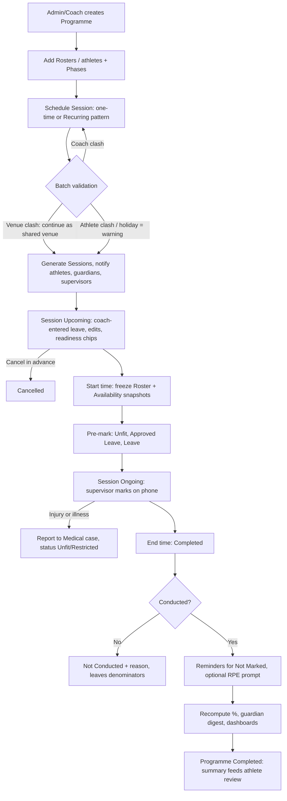

# Standalone AMS — Athlete Lifecycle Flow (v0.1 draft, 2026-11-24)

Status: draft. Part A maps the **whole athlete lifecycle in a High Performance Centre** and shows which module owns each stage. Part B is the **detailed flow for Stage 3-4 (Programme and Session)**, the first stage we are designing in depth. Items **[PROPOSED]** await PM confirmation. Inputs: `onboarding_and_rbac.md`, `import_design.md`, `training_and_attendance.md`, and Shrey's `2026-11-24-ams-medical-and-injury-cli-context-v1.md` (reviewed; the three blockers B1-B3 below are from that review).

---

## Part A. The whole lifecycle

### A1. Two different "states" (keep them separate)
| Axis | Values | Owner |
|---|---|---|
| **Account/membership state** | Invited → Awaiting Guardian Consent (minors) → Active → Deactivated | Onboarding |
| **Availability state** (changes daily) | Fit / Restricted / Unfit | Medical & Injury |
| **Career stage** (where the athlete is in the centre's pathway) | Intake → Inducted → In Programme → Reviewing → Transition → Alumni | This doc **[PROPOSED]** |

Career stage is not a permission and not a role; it is a label the Admin/Coach moves an athlete along, and it drives what the dashboards show and which prompts fire. Availability and career stage are independent (an Unfit athlete is still "In Programme").

### A2. Stage map
| # | Stage | What happens | Owner module | Primary actors | Status of design |
|---|---|---|---|---|---|
| 1 | **Intake** | Athlete enters the centre: bulk import (selection/trials happen outside AMS in v1), guardian consent for minors | Onboarding | Admin, Guardian | Designed (v0.1) |
| 2 | **Induction & baseline** | First login, profile complete, baseline assessment (anthropometrics, fitness tests, medical baseline is **not** required: everyone starts Fit) | Onboarding + Assessments | Athlete, Coach, S&C, Medic | Onboarding done; baseline = Assessments, **not designed** |
| 3 | **Plan** | Athlete is placed into Rosters and Programmes; periodised plan with Phases; sessions scheduled | Training | Admin, Coach | **Part B** |
| 4 | **Train** | Sessions run; attendance, availability, load captured | Training + Attendance | Coach, Team Mgr, Athlete | **Part B** |
| 5 | **Monitor** | Availability (Fit/Restricted/Unfit), injury/illness cases, daily "how is it today", later wellness and load trends | Medical & Injury | Athlete, Coach, Medic, Physio | Shrey's v1.0; reviewed, blockers open |
| 6 | **Assess** | Periodic testing, biomechanics, performance analysis, benchmarks | Assessments | S&C, Biomechanist, Analyst, Coach | Not designed |
| 7 | **Compete** | Selection, availability check, travel readiness, results | Squads/Selection (+ TMS later) | Coach, Team Mgr | Not designed; see O-L3 |
| 8 | **Review & progress** | Periodic athlete review: attendance, load, assessments, availability; set goals; move squad/age-group/pathway level | Athlete Development | Coach, Athlete, Guardian (minor) | Not designed |
| 9 | **Transition & exit** | Turns 18 (guardian access ends), graduates to next squad, released, retires, becomes Alumni; data retained, access restricted | Onboarding + all | Admin, Athlete | Partly (age 18, deactivation); parked O9 |

Cross-cutting at every stage: audit with active role, role-scoped dashboards, guardian visibility for minors, org-scoped data, notifications in neutral wording for health.

### A3. How the stages hand off (data flows)
- **Plan → Train:** Sessions generated from patterns carry Roster, Venue, supervisors, session type.
- **Monitor → Train:** availability at session start decides pre-marked attendance (Part B, rule P7).
- **Train → Monitor:** an in-session injury report creates a case; load (RPE × minutes) feeds later trend views.
- **Train → Assess/Review:** attendance %, engagement %, hours by type and load are the training inputs to a review.
- **Assess → Plan:** results inform the next Programme/Phase (human decision, never automatic).
- **Review → Plan/Exit:** pathway move, squad change, graduation or release.

### A4. Role view of the lifecycle
| Role | Lives mainly in stages |
|---|---|
| Admin | 1, 3, 9; oversight of 4-5 |
| Coach | 3, 4, 7, 8 |
| Team Manager | 3 (logistics), 7 |
| Medic / Physio | 5 |
| S&C, Biomechanist, Analyst, Nutritionist, Psychologist | 6 (and 5 for load/wellness later) |
| Athlete | 4-5 daily; 8 periodically |
| Guardian (minor) | 1 (consent), notifications in 4-5, 8 |

---

## Part B. Plan and Train: Programme & Session flow

### B0. Entities and states (recap, see `training_and_attendance.md`)
Programme (Upcoming → Ongoing → Completed / Cancelled) → Schedule Pattern (active / stopped) → Session (Upcoming → Ongoing → Completed / Cancelled; outcome Conducted / Not Conducted) → Attendance record.

### B1. Programme set-up (Stage 3)
**Actors:** Admin, or Coach for their own programmes **[PROPOSED, O-T3]**.
1. **Create Programme:** name, sport(s), period, owner, optional Phases, default session types, load capture on/off.
2. **Add participants:** pick Rosters and/or individual athletes. Athlete may be in many Rosters and many Programmes (multi-sport).
3. **Validation:** name uniqueness within org + sport **[PROPOSED, closes old open question]**; period sane; owner holds Coach or Admin role.
4. Programme saved as **Upcoming** (or Ongoing if the period has started). Cancel allowed only while Upcoming; no emergency stop once Ongoing.

*Guardrail:* a Programme with zero participants or zero sessions is allowed (draft-like) but shows "No sessions scheduled" on the dashboard.

### B2. Scheduling sessions (Stage 3)
Entry point: **Schedule Session** form with **One-time / Recurring** toggle (settled).
1. Fill: date(s) or pattern (label, days, time, Venue), session type, Rosters/athletes (default from Programme), supervisors, objectives.
2. **Batch validation, one consolidated summary before commit:**
   | Check | Result |
   |---|---|
   | Coach/supervisor double-booked | **Block** |
   | Venue double-booked | **Warning, overridable**: continue marks both sessions "Shared venue" |
   | Athlete in two overlapping sessions | **Warning** (list athletes) |
   | Falls on a skip-date / org holiday | Warning |
   | Athletes currently **Unfit/Restricted** in the Roster | **Info only** (no blocking; availability can change before the session) |
   | Backdated | Allowed ≤ 30 days with reason, flagged `reconstructed` |
3. **Commit:** real Session rows generated; Pattern stored. Notifications: athletes, guardians (minors), supervisors. Calendar entries appear on every affected dashboard.
4. **Manage later:** Patterns list on the Programme page. Edit scope "this session only / this and following" (Upcoming only, pattern-scoped), stop pattern, add skip-dates. Extending an Ongoing Programme generates from every `active` pattern.

### B3. Before the session (Upcoming)
- **Changes:** time/venue/supervisor edits and cancellations notify everyone affected. Cancel = called off in advance (distinct from Not Conducted).
- **Leave (coach-entered, decided 2026-11-24):** Coach or Admin records leave for the athlete → dates pre-mark `Leave` (missed); Admin may convert to **Approved Leave** (excused). Guardian notified of every leave recorded for a minor. Athletes/guardians do not submit leave in v1.
- **Availability readiness:** the supervisor's session view shows each rostered athlete's chip (Fit / Restricted + permitted activity / Unfit). Coach sees status only, never cause.
- **Roster changes** before start flow into the session; an athlete added to a Roster mid-programme appears from the next Upcoming session.

### B4. Session start → Ongoing (Stage 4)
At the start time the system freezes two snapshots **[PROPOSED, review blocker B3]**:
1. **Roster snapshot** (settled).
2. **Availability snapshot:** each athlete's availability status at that moment. This is what attendance derives from; later or backdated status entries **never** rewrite a completed session (only Medic/Admin correction with reason, audited).

**Pre-marking rules (P7):**
| Snapshot | Pre-marked attendance | Counts as |
|---|---|---|
| Fit | Not Marked (awaits supervisor) | n/a |
| Restricted | Not Marked; expected Present, with restriction badge | n/a |
| Unfit, reason Injury/Illness | **Unfit** | Excused |
| Unfit, reason Other | Not Marked, flagged "Unfit (other)" | Supervisor decides; default Missed **[PROPOSED, review blocker B1]** |
| Approved leave | Approved Leave | Excused |
| Requested leave (not approved) | Leave | Missed |

*Self-reported Unfit that no Medic or Coach has confirmed* is counted as Excused but shown in reports as **"excused, unconfirmed"**, so the percentage can't be silently gamed (B1).

### B5. During the session (Ongoing): marking
**Who:** Admin, or a supervisor assigned to the session with the Mark Attendance permission (Coach, Team Manager, S&C Coach). Non-supervisors can view, not mark. A person holding both Coach and Medic roles marks only in the Coach role.
1. Open session on a phone; roster pre-filled per P7; one-tap **Mark all Present**, then flip exceptions (Absent, Leave, Holiday, In-Competition, In-Recovery, In S&C). Reason mandatory for anything but Present.
2. **In-session injury or illness:** the supervisor taps **Report** on an athlete (works for **any athlete in a session they supervise**, not only "own" athletes) → creates a Health case (Stage 5), athlete status becomes Unfit/Restricted immediately, attendance for this session stays **Present (left early)** with a note, never Absent.
3. **Late arrival / early departure:** recorded as notes on the Present record in v1 (no partial-attendance minutes) **[PROPOSED, O-L5]**.
4. Not Marked remains visible as a raw count.

### B6. End of session → Completed
- Session auto-moves to **Completed** at end time; outcome defaults to Conducted. Supervisor may set **Not Conducted** with a reason (Holiday, Weather, Facility, Staff, Other): the session leaves every athlete's denominator.
- **Supervisor reminder** (e.g. 30 min after end, then next morning) if any athlete is Not Marked. Marking never closes (settled); audit is the only control.
- **Session notes** (what was done, objectives met) captured by the supervisor; visible to staff roles; not shown to athletes unless the coach shares **[PROPOSED]**.
- If **load capture** is on (screen ships Phase 2; fields reserved in v1): the **supervisor enters RPE (1-10)** for the session; load = RPE × duration. Athletes do not self-log. Missing RPE is not penalised.

### B7. After the session (Stage 4 → feeds 5, 6, 8)
- **Percentages recompute** (Attendance % = Present ÷ (Present + Missed); Engagement % includes excused). Not Marked never enters a denominator.
- **Guardian digest** for minors: absences and unmarked sessions, not per-session pushes.
- **Corrections:** any authorised marker can change a record at any time; each change shows actor, active role, time, old → new, reason on the record itself.
- **Dashboards update:** Coach (who missed, trends), Admin (centre-wide attendance, unmarked sessions by supervisor), Athlete (own %, load).

### B8. Programme progress and completion
- **Phase change:** at a Phase boundary the Programme view updates the label; no automatic rescheduling.
- **Extend:** end date extended on an Ongoing Programme → sessions generate from every active pattern, with the same batched validation. **Shrink:** only down to the last session that has attendance data; delete future sessions first.
- **Complete:** on the end date the Programme becomes Completed (terminal). The **Programme summary** (attendance, hours by type, load, availability days lost, Not Conducted count, by athlete) is generated and offered as the input to athlete reviews (Stage 8).
- **Cancel:** only while Upcoming; kept as a record.

### B9. Exits and edge cases inside Plan/Train
| Event | Behaviour |
|---|---|
| Athlete removed from a Roster/Programme | History kept, disappears from future sessions |
| Athlete deactivated or released | Same; past attendance remains in reports with name (O-T9) |
| Athlete turns 18 mid-programme | Guardian notifications stop with their access |
| Coach departs | Admin owns their programmes/sessions until reassigned |
| Coach and Medic are the same person | Marks as Coach only; clinical actions only in Medic role |
| Athlete in two Rosters in one session | One attendance record |
| Session Not Conducted after marking | Records retained, excluded from denominators, flagged |
| Supervisor removed after records exist | Records stay, audit preserved |
| Unfit athlete listed as Present anyway | Allowed by supervisor with reason (e.g. observing); flagged for Medic/Coach review |

### B10. Flow at a glance (Mermaid)

---

## Part C. Open points (this doc)
- **Programme/Session open points O-T1..O-T9 resolved 2026-11-24** (see `training_and_attendance.md` §12). Leave and RPE are coach-entered.
- **Decided 2026-11-24:** Venues stay in v1 (briefly removed, then reversed). Rosters are created by **Admin only** (Team Manager manages members of rosters they manage). Venue clash is an overridable warning that marks sessions "Shared venue". Coaches attach to sessions, not athletes.
- **O-L1.** Is **Career stage** (Intake → … → Alumni) wanted as a tracked label, or is membership state + Roster/Programme membership enough?
- **O-L2.** **Pathway levels** (e.g. Development / Performance / Elite squads): modelled as Rosters, or a distinct first-class pathway concept with promotion rules?
- **O-L3.** **Compete stage:** in AMS (selection + availability) or delegated to TMS later? Affects session type `Competition`.
- **O-L4.** **Selection/trials intake** before import: out of AMS in v1 (proposed). Confirm.
- **O-L5.** Partial attendance (late/early minutes): notes only in v1?
- **O-L6.** Review blockers B1-B3 from Shrey's doc (self-report excusing, coach override of self-reported Unfit, retroactive status) must be settled; Part B assumes my proposals.
- Carry-over: O-T1..O-T9 (training_and_attendance.md), O-I1..O-I7 (import), parked O9 (guardian depth, age 18).

## Part D. Suggested next
Stage 5 alignment with Shrey (blockers B1-B3), then Stage 2 baseline + Stage 6 Assessments, then Stage 8 Review. A FigJam board of Part A + B10 can be built if wanted.
