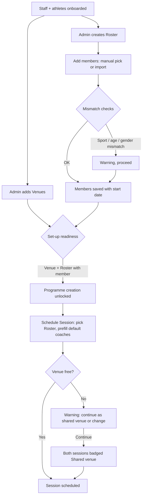

# Standalone AMS — Centre Set-up Flow (v0.2 draft, 2026-11-24)

Status: draft. Covers what must exist **after staff and athletes are onboarded and before the first Programme**: Venues, Rosters, and the readiness checklist that unlocks Programme creation. Items **[PROPOSED]** await PM confirmation.

Inputs: `onboarding_and_rbac.md`, `import_design.md`, `training_and_attendance.md`, `athlete_lifecycle_flow.md` (Stage 3 Plan depends on this).

**Decided by PM (2026-11-24):**
- Venues stay in v1 as a simple org-owned list. **No venue-level "shared use" setting and no open hours** (scratched from Shrey's doc). A venue clash is an **overridable warning**; overriding marks that session as a **shared venue**.
- **Rosters are created by Admin only.**
- **Coaches are not assigned to individual athletes.** Coaches are assigned to **sessions** (the source of truth) and may optionally be attached to a Roster as default supervisors.

v0.1 changes: Team Manager no longer creates rosters; per-athlete coach mapping dropped; venue clash is no longer a hard block.

---

## 1. Where this sits
First-run checklist today (onboarding doc): add centres (optional) → import staff → import athletes → create first programme. This doc inserts two steps before the last one:

`Add centres [optional] → Import staff → Import athletes → **Add venues → Create rosters + add members** → Create first programme`

Programme creation shows a **Set-up readiness** panel until both are done (see S4).

## 2. Entities
- **Venue**: name, centre (optional), capacity (optional), status (Active / Inactive). Org-owned, no external dependency. No shared-use flag, no open hours.
- **Roster** (squad/team): name, sport(s), age group (optional), gender category (Men / Women / Mixed, optional), centre (optional), status (Active / Archived), created_by (Admin), managed_by (Team Manager(s), optional), **default coaches** (optional, 0..n).
- **Roster membership**: (roster, athlete, start_date, end_date nullable, added_by). History kept; an athlete may be in many Rosters at once (multi-sport HPC).
- **Coach on a session** (not on an athlete): set on Schedule Pattern / Session as supervisors. A Roster's **default coaches** only **prefill** that field when the roster is picked; they can be changed per session or pattern. Coaches are never mapped to individual athletes.

## 3. Flow

### S1. Add venues (Admin)
1. **Set-up → Venues → Add Venue**: name, centre (if used), capacity (optional).
2. Validation: name unique within the org (or centre); capacity, if given, is a positive number.
3. Edit anytime. **Deactivate** is blocked while future sessions use the venue until they are moved or cancelled **[PROPOSED]**; deactivated venues stay on past sessions and reports.
4. Bulk add via CSV/XLSX (`name, centre, capacity`), partial commit, insert-only **[PROPOSED]**.

**Venue clash at scheduling (rule, owned here, applied in Schedule Session):**
- If a venue is already booked at an overlapping time, the batch-validation summary shows a **Warning**: "Venue is already used by <session> at <time>".
- The scheduler may **Continue as shared venue**. Both sessions then carry a **Shared venue** badge (a session-level marker, not a venue setting). Nothing else changes.
- If they do not continue, they pick another time or venue.
- Reports can filter or count sessions marked shared. No reason is required **[PROPOSED]**.
- Coach/supervisor double-booking stays a **hard block** (unchanged).

### S2. Create a roster (Admin only)
1. **Set-up → Rosters → Create Roster**: name, sport(s), age group, gender category, centre, optional managing Team Manager(s), optional default coaches.
2. Validation: name unique within org + sport **[PROPOSED]**; at least one sport; Team Manager and coaches must hold those roles.
3. Rosters start empty and are saved **Active**.

### S3. Add members (Admin; Team Manager for rosters they manage)
Both paths available on the roster page **[PROPOSED defaults]**:
- **Manual pick:** search/filter org athletes (sport, age group, gender, centre, name); add one or many with a start date (default today).
- **Bulk import:** CSV/XLSX `roster_name, athlete_email_or_id, start_date`. Same engine as athlete import: preview, partial commit, per-row error report, insert-only.

| Check | Result |
|---|---|
| Athlete already in this roster | Skip (info) |
| Athlete's sport not in the roster's sport(s) | **Warning**, can proceed |
| Athlete outside the roster's age group or gender category | **Warning**, can proceed |
| Athlete Awaiting Guardian Consent (minor) | Can be added, badge shown; no notifications until Active |
| Athlete Deactivated | Cannot be added |
No size limit in v1 **[PROPOSED]**; the roster page shows the member count.

### S4. Set-up readiness (gate for Programme creation)
| Item | Done when |
|---|---|
| Venues | at least 1 Active venue |
| Rosters | at least 1 Active roster with at least 1 member |
Coaches are **not** part of the gate: they are chosen per session at scheduling. A roster with no default coaches is normal.

### S5. Changing things later
| Event | Behaviour |
|---|---|
| Member removed from a roster | Membership gets an end date; history and past attendance stay; they drop off **future** sessions only |
| Athlete deactivated | All memberships end automatically; history kept |
| Roster archived | **Blocked** while it has Upcoming or Ongoing sessions until moved or cancelled **[PROPOSED]**; archived rosters are read-only, still in reports |
| Roster renamed | Allowed; past sessions keep the name at the time (roster snapshot) |
| Default coach leaves (deactivated) | Removed from the roster default list; existing sessions keep supervisors until edited; Admin owns orphaned sessions (existing rule) |
| Team Manager leaves | Roster stays; Admin manages until reassigned |
| Athlete added mid-programme | Appears from the next Upcoming session only (existing rule) |
| Shared-venue session later moved or its twin cancelled | Badge is recomputed; shown only while an overlap still exists |

## 4. Who can do what
| Action | Admin | Team Manager | Coach | S&C Coach | Medic/Physio | Other staff | Athlete | Guardian |
|---|---|---|---|---|---|---|---|---|
| Venues: create / edit / deactivate | Full | Read | Read | Read | Read (name) | Read (name) | Read (name) | Read (name) |
| Rosters: create / edit / archive / set default coaches | **Full** | No | No | No | No | No | No | No |
| Roster members: add / remove / import | Full | **Rosters they manage** | No | No | No | No | No | No |
| Assign managing Team Manager(s) to a roster | Full | **Yes** (rosters they manage) | No | No | No | No | No | No |
| Override venue clash (mark shared) | Yes | Yes (logistics) | Own sessions | Own sessions | No | No | No | No |
| View roster | All | Managed + scope | Where default coach or supervisor | Same | Names + status chip | Scope | Own roster names | Child's roster names |

**Dashboard impact:** Team Manager still needs an early minimal dashboard (managed rosters, members, upcoming sessions, status chips), now smaller since they do not create rosters. Roles can be assigned only once their dashboard exists, so this moves earlier **[PROPOSED]**.

## 5. Rules
| # | Rule |
|---|---|
| R-1 | Roster name unique within org + sport. |
| R-2 | An athlete may belong to many Rosters; one attendance record per session regardless. |
| R-3 | Membership is dated; nothing is deleted, only ended. |
| R-4 | Sport / age-group / gender mismatches warn, never block. |
| R-5 | Only Admin creates, edits or archives Rosters. Team Manager manages membership and managers of rosters naming them. The Team Manager role can be granted to any user (incl. a Coach). |
| R-6 | Venue name unique within org (or centre); deactivation blocked while future sessions use it. |
| R-7 | Venue overlap is a warning; continuing marks both sessions **Shared venue**. Coach overlap is a hard block. |
| R-8 | Coaches attach to sessions, never to athletes. Roster default coaches are a prefill only. |
| R-9 | Every change (roster, membership, default coaches, venue, shared override) is audited with actor, active role, time, old to new. |
| R-10 | Minors awaiting guardian consent can be rostered but receive no notifications until Active. |

## 6. Flow at a glance (Mermaid)

## 7. Open points
- **O-S2 (resolved 2026-11-24).** Team Manager adds/removes members on rosters that name them as manager.
- **O-S3 (resolved 2026-11-24, interpretation).** Both **Admin and Team Manager** can assign managing Team Managers to a roster. Confirm that Team Manager assignment of other managers is intended, not only Admin.
- **Role sharing (PM, 2026-11-24):** Admin can grant the Team Manager role to **any user, including a Coach**. A person holding Coach + Team Manager uses the existing role switcher; roster actions are done in the Team Manager role and audited with the active role (same rule as Coach + Medic).
- **O-S4.** Confirm no roster size limit in v1.
- **O-S5 (resolved).** Shared use is a session-level override tag, not a venue setting.
- **O-S6.** Is **centre** worth modelling for venues and rosters now (centres are optional; org tree skipped)?
- **O-S7.** Reconcile Shrey's training doc: rename Batch to Roster, remove coach-created batches, remove venue open hours and shared-use flag, change venue clash from block to overridable warning.
- **O-S8.** Does a Coach who is only a default coach on a roster (no session yet) see the roster? Proposed yes, read-only.
